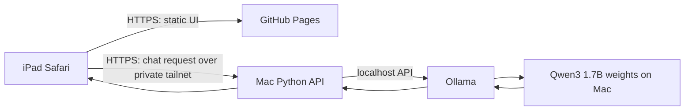

# Deployment plan: GitHub Pages UI + private Mac model

## Goal

Open the chat from a stable GitHub Pages URL on the iPad, while inference and thesis data stay on the Mac. GitHub Pages publishes the browser interface; it does **not** run Python, Ollama, or model weights.

## Proposed request path

The iPad must be signed into the same private Tailscale network as the Mac. Keep Ollama and the Mac API running, and prevent the Mac from sleeping during use. If the Mac is off or disconnected, the Pages page still opens but it cannot get model answers.

## What is automated

1. A GitHub Actions workflow can publish the static frontend whenever changes are pushed to the selected branch. GitHub Pages serves static HTML/CSS/JavaScript and supports workflow-based publishing ([GitHub Pages docs](https://docs.github.com/en/pages/getting-started-with-github-pages/using-custom-workflows-with-github-pages)).
2. On Mac login, a local service can start Ollama (if needed) and the Python API automatically.
3. Tailscale Serve is the intended private HTTPS path from the iPad to the Mac API; it serves to tailnet devices and requires HTTPS certificates enabled for the tailnet ([Tailscale Serve docs](https://tailscale.com/docs/features/tailscale-serve)). The model is not copied to GitHub or the iPad.

These are separate automations: GitHub deploys the UI; macOS starts the private model service. The Mac has to be online for inference.

## Changes needed in this prototype

- Separate the static UI from the API deployment. Build a Pages-ready frontend whose API base URL is configurable, rather than assuming the API shares the UI's origin.
- Give the Mac API an HTTPS URL reachable only inside the tailnet. A public Pages page is HTTPS, so the browser must not call an insecure HTTP API. Tailscale Serve or an equivalent tailnet-only HTTPS proxy is the intended direction.
- Add an `OPTIONS` preflight response and CORS allowlist for the exact Pages origin. Do not use `Access-Control-Allow-Origin: *` for an authenticated API.
- Keep the API bound to loopback behind the private HTTPS proxy where possible; do not open router ports or expose Ollama's port `11434`.
- Keep the API password entered at runtime. Never put it in frontend JavaScript, GitHub Actions variables that are shipped to the browser, or the repository.
- Add secure session handling/rate limits and review the current shared-password gate before relying on it beyond personal testing.
- Add a GitHub Actions Pages workflow and set the repository's Pages source to GitHub Actions.
- Add a macOS login service for the API and a clear health/status check. Ollama must already be installed and the selected model pulled locally.

## Privacy and availability boundaries

- Model weights, inference, and prompts stay on the Mac in the proposed setup. The static UI source and site are public if the repository and Pages site are public; do not put thesis data, secrets, or chat logs in frontend files.
- Chat API traffic travels from the iPad to the Mac through the private tailnet. The current prototype does not persist chat history.
- iPad storage/RAM are not pooled into Mac resources by this deployment. The iPad is a browser client; the Mac does the inference.
- Pages availability does not imply model availability. Mac power, network, Ollama, Python API, and tailnet access are all required for an answer.

## Delivery phases

| Phase | Deliverable | Completion check |
|---|---|---|
| 0. Baseline | Reproducible local evaluation of `qwen3:1.7b` on the Mac | Answers and timing metadata saved locally |
| 1. Private service | Mac API reachable from the iPad over local Wi-Fi/Tailscale | iPad receives an answer; Mac is the only inference host |
| 2. Split frontend | API URL configurable; exact-origin CORS and HTTPS path work | Pages UI can call the tailnet-only Mac API |
| 3. Automation | Push deploys frontend; Mac login starts its local service | Both flows work after restart without manual launch |
| 4. Hardening | Better auth, access revocation, health/logging controls | Personal security review completed before broader sharing |

## First deployment acceptance checks

- The GitHub repository contains no model weights, thesis documents, API password, or private chat logs.
- Opening the Pages URL while disconnected from Tailscale cannot reach the Mac API.
- The iPad can get an answer with Tailscale connected and the Mac awake.
- Turning off the Mac makes inference unavailable, while the static page may remain available.
- Ollama stays bound locally; no router port forwarding is configured.

This is a design note, not a claim that Pages deployment or remote access has already been configured.
